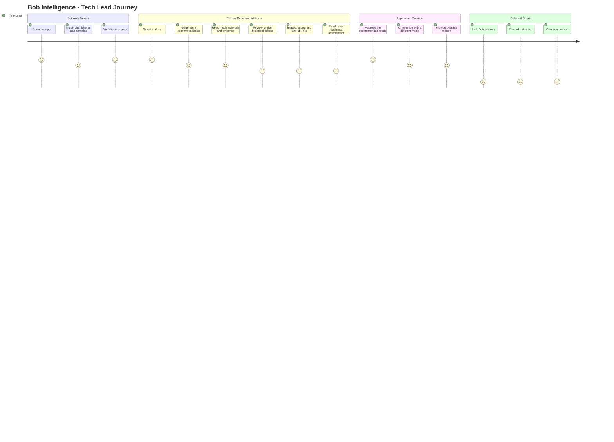
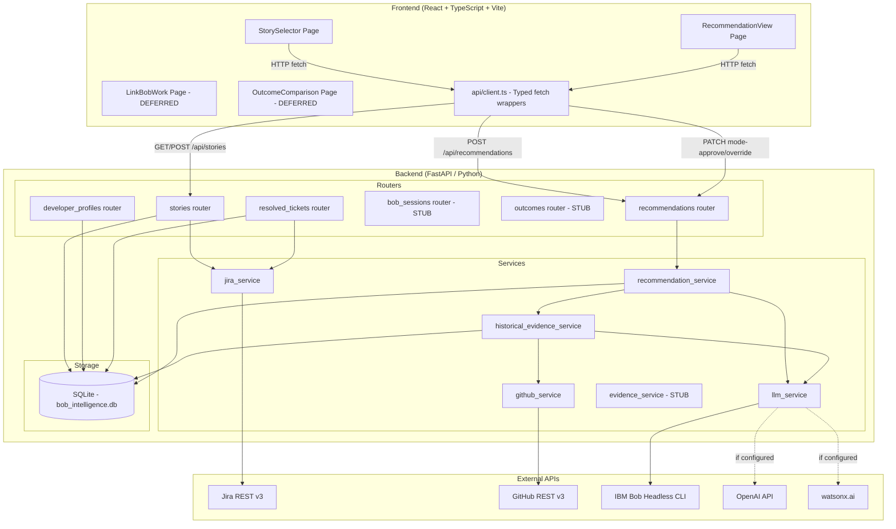
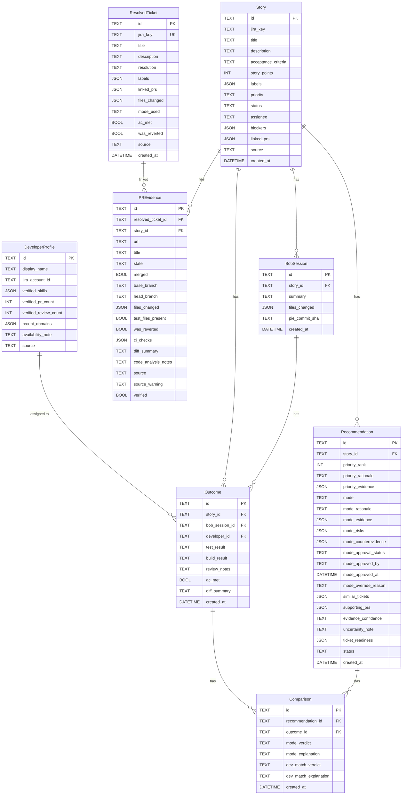
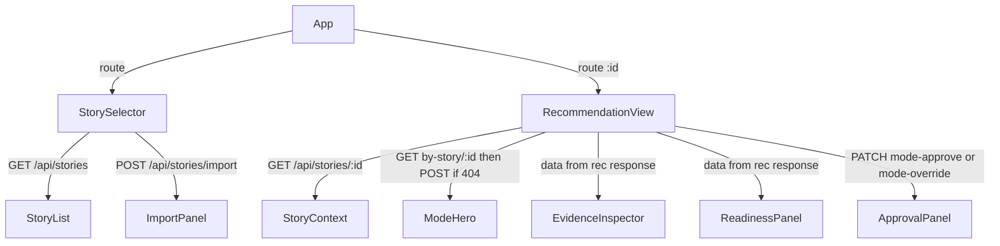
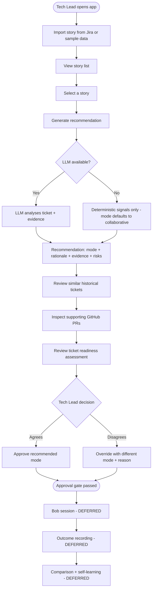

# Bob Intelligence — Application Technical Overview

> **Audience:** Frontend developers, new backend contributors, and technical leads onboarding to this project.
> **Scope:** Grounded in the repository as it exists today. Every technical claim references a real source file.
> **Conventions:** Labels indicate **[IMPLEMENTED]**, **[PLANNED]**, **[PROPOSED]**, or **[DEFERRED]** status.

---

## Table of Contents

1. [Application Overview](#1-application-overview)
2. [Technical Architecture](#2-technical-architecture)
3. [Application Functionality](#3-application-functionality)
4. [Business-User Interactions](#4-business-user-interactions)
5. [Frontend-to-Backend Mapping](#5-frontend-to-backend-mapping)
6. [Current State and Gaps](#6-current-state-and-gaps)
7. [Recommended Frontend Structure](#7-recommended-frontend-structure)
8. [Summary](#8-summary)

---

## 1. Application Overview

### 1.1 Purpose and Business Problem

Software teams using Jira face a recurring challenge: deciding how much automated assistance is appropriate for each ticket before work begins. Human engineers are expensive; fully autonomous execution can produce incorrect or risky results without proper oversight. The decision — "should a bot handle this, or should a human lead it?" — is currently made informally, based on gut feel.

**Bob Intelligence** is a recommendation system that automates this decision. Given a Jira story, it analyses the ticket's description quality, historical evidence from similar resolved tickets, and GitHub PR patterns, then recommends one of three execution modes:

| Mode | Meaning |
|------|---------|
| `bob_led` | IBM Bob (an AI agent) handles the ticket autonomously |
| `collaborative` | Bob and a human engineer work together |
| `human_led` | A human engineer must own and drive the work |

The system surfaces supporting evidence, risks, counterevidence, and a confidence level so that a **Tech Lead** can make an informed approval decision — or override the recommendation — before any automated work begins.

### 1.2 Target Users and Responsibilities

| User Role | Responsibilities |
|-----------|-----------------|
| **Tech Lead** | Reviews mode recommendations, approves or overrides the suggested execution mode, controls the gate before Bob-led work starts |
| **Developer / Team Member** | (future) Assigned to a ticket; views the recommendation context for their assigned work |
| **Platform Administrator** | Configures environment variables (Jira, GitHub, LLM credentials), seeds the resolved-ticket database |

### 1.3 Complete User Journey

The primary end-to-end flow for a Tech Lead is:



---

## 2. Technical Architecture

### 2.1 Technology Stack

| Layer | Technology | Version | Notes |
|-------|-----------|---------|-------|
| Backend Language | Python | 3.14.0b4 | FastAPI async |
| Web Framework | FastAPI | latest | ASGI, async |
| ORM | SQLAlchemy | 2.0.41 | Declarative models |
| Validation | Pydantic | 2.14.0 | Request/response schemas |
| Database | SQLite | 3 | File-backed; `bob_intelligence.db` |
| Frontend Language | TypeScript | 5.8.3 | |
| Frontend Framework | React | 19.1.0 | |
| Frontend Router | React Router | 7.6.3 | |
| Frontend Bundler | Vite | 6.3.5 | Dev server on port 5173 |
| LLM (primary) | IBM Bob Headless | — | Subprocess invocation |
| LLM (alternatives) | OpenAI / watsonx.ai | — | Configurable via env var |
| Similarity Search | TF-IDF (custom) | — | In-memory; no external dependency |
| External APIs | Jira REST v3 | — | `JIRA_BASE_URL` configured |
| External APIs | GitHub REST v3 | — | `GITHUB_TOKEN` optional |
| Test Runner | pytest | — | 9 test files |
| Integration Tests | Bash smoke test | — | `scripts/smoke_test.sh` |
| Containerisation | Docker + Docker Compose | — | Multi-stage builds; nginx reverse proxy for frontend |

### 2.2 Project Structure

```
bob-intelligence/
├── backend/                  # Python FastAPI API + business logic
│   ├── main.py               # App entry point, CORS, lifespan, router registration
│   ├── database.py           # SQLAlchemy engine and session factory
│   ├── models.py             # All ORM models
│   ├── schemas.py            # All Pydantic request/response schemas
│   ├── routers/              # One file per resource group (stories, recommendations, etc.)
│   ├── services/             # Business logic: jira, recommendation, evidence, github, llm
│   ├── sample_data/          # JSON seed files for offline development
│   ├── tests/                # pytest test suite
│   ├── conftest.py           # Test fixtures: isolated test DB, LLM stub
│   ├── pytest.ini            # pytest configuration
│   ├── .env.example          # Configuration template
│   ├── requirements.txt      # Production Python deps
│   ├── requirements-dev.txt  # Dev/test deps
│   └── Dockerfile            # Container build
├── frontend/                 # React + TypeScript + Vite UI — fully implemented
│   └── src/
│       ├── main.tsx          # App entry; route definitions
│       ├── api/
│       │   ├── client.ts     # Typed API client — all endpoints implemented
│       │   └── types.ts      # TypeScript interfaces for all API types
│       ├── components/
│       │   ├── AppShell.tsx  # Navigation, header, connection indicator, dark mode
│       │   ├── ApprovalPanel.tsx  # Approve/override form (extracted component)
│       │   └── ui.tsx        # Shared design-system components (Badge, Card, Button, etc.)
│       └── pages/
│           ├── StorySelector.tsx      # Fully implemented — API wired, filter tabs, import panel
│           ├── RecommendationView.tsx # Fully implemented — all panels, approval gate
│           ├── LinkBobWork.tsx        # Deferred — informational stub
│           └── OutcomeComparison.tsx  # Deferred — informational stub
├── scripts/
│   └── smoke_test.sh         # Milestone 4a end-to-end smoke test
├── docs/                     # Documentation
├── Makefile                  # Common dev shortcuts (setup, test, docker-up, etc.)
├── docker-compose.yml        # Multi-container deployment (backend + frontend + nginx)
├── railway.json              # Railway.app deployment config
└── bob_intelligence.db       # SQLite database file (production)
```

### 2.3 Architecture Diagram



### 2.4 Frontend Architecture

The frontend is a **React Single-Page Application** built with Vite. Both primary screens are **fully implemented** — API calls are wired, all evidence panels render, and the approval gate is interactive.

**Route Map** (defined in [`frontend/src/main.tsx`](../frontend/src/main.tsx)):

| Route | Component | Purpose | Status |
|-------|-----------|---------|--------|
| `/` | `StorySelector` | List and import stories | **[IMPLEMENTED]** — fully wired, filter tabs, import panel |
| `/stories/:id/recommendation` | `RecommendationView` | View recommendation, approve/override | **[IMPLEMENTED]** — all panels, approval/override gate wired |
| `/stories/:id/bob-session` | `LinkBobWork` | Link a Bob work session | **[DEFERRED]** — backend returns 501 |
| `/stories/:id/outcome` | `OutcomeComparison` | Record and compare outcomes | **[DEFERRED]** — backend returns 501 |

**API Client** ([`frontend/src/api/client.ts`](../frontend/src/api/client.ts)):
- `BASE_URL` reads from `VITE_API_BASE_URL` env var; falls back to `""` (Vite proxy handles `/api/*` in dev)
- All MVP endpoints fully implemented: `healthCheck`, `listStories`, `getStory`, `importSampleStories`, `importJiraStory`, `createRecommendation`, `getRecommendation`, `getRecommendationForStory`, `approveMode`, `overrideMode`, `listResolvedTickets`
- Error handling: FastAPI `detail` field (string or array) is unwrapped into human-readable messages

**Type Definitions** ([`frontend/src/api/types.ts`](../frontend/src/api/types.ts)):
- Complete TypeScript interfaces: `Story`, `Recommendation`, `EvidenceItem`, `RiskItem`, `SimilarTicketItem`, `SupportingPRItem`, `TicketReadiness`, request/response bodies
- `EvidenceItem` and `RiskItem` are structured objects (`{ source, description, verified }` and `{ description, severity }`) not plain strings

**Shared Components** ([`frontend/src/components/`](../frontend/src/components/)):
- [`AppShell.tsx`](../frontend/src/components/AppShell.tsx): Application shell — sidebar navigation, header with connection-status indicator, dark/light theme toggle, search field pass-through
- [`ApprovalPanel.tsx`](../frontend/src/components/ApprovalPanel.tsx): Self-contained approve/override form extracted from `RecommendationView`
- [`ui.tsx`](../frontend/src/components/ui.tsx): Design-system primitives: `Badge`, `ModeBadge`, `ApprovalBadge`, `ConfidenceBadge`, `PriorityBadge`, `SourceBadge`, `Card`, `Button`, `MetricCard`, `EmptyState`, `ErrorBanner`, `WarningBanner`, `SampleDataBanner`, `SectionHeading`, `Skeleton`, `ProgressBar`, `Divider`, `MetaRow`

### 2.5 Backend Architecture

The backend follows a **layered architecture**:

```
HTTP Request
    ↓
Routers (routers/*.py)       — HTTP routing, request validation, response serialisation
    ↓
Services (services/*.py)     — Business logic, external API calls, LLM orchestration
    ↓
Models (models.py)           — SQLAlchemy ORM, schema definitions
    ↓
Database (database.py)       — SQLite engine, session factory
```

**Application startup** ([`backend/main.py`](../backend/main.py)):
- CORS middleware allows `http://localhost:5173` and `http://127.0.0.1:5173`
- Lifespan hook calls `init_db()` then auto-seeds sample resolved tickets if the table is empty — no manual import step needed on first run
- Six routers registered under `/api/...`
- Health endpoint: `GET /api/health → {"status": "ok"}`

### 2.6 Database Models and Relationships

All models are defined in [`backend/models.py`](../backend/models.py).



**Important constraint:** `story_points` is stored as metadata only. It **must never** influence any recommendation, priority ranking, or mode decision. See [`backend/models.py`](../backend/models.py) and [`backend/services/recommendation_service.py`](../backend/services/recommendation_service.py).

---

## 3. Application Functionality

### 3.1 Jira Ticket Discovery and Selection **[IMPLEMENTED]**

**Business description:** The Tech Lead imports a Jira story into the system by providing its key (e.g., `PIE-42`). The system fetches the full story from Jira using a personal API token and stores it locally. If no Jira credentials are configured, sample stories can be loaded instead.

**Technical implementation:**
- Router: [`backend/routers/stories.py`](../backend/routers/stories.py)
- Service: [`backend/services/jira_service.py`](../backend/services/jira_service.py)
- Endpoint: `POST /api/stories/import` with `{import_source: "jira"|"sample", jira_key?: string}`
- Jira call: `GET /rest/api/3/issue/{jira_key}?expand=names`
- ADF (Atlassian Document Format) descriptions are recursively parsed to plain text
- Custom fields (story_points, AC) resolved via env-configured field keys
- Duplicate detection: if a story with the same `jira_key` already exists, it is skipped and counted in `skipped_duplicates`
- Response includes `source_status`: `"jira"`, `"sample_import"`, `"credentials_missing"`, or `"jira_error"`

**Fields extracted from Jira:**
`summary` → `title`, `description` (ADF or plain text), `labels`, `priority.name`, `status.name`, `assignee.displayName`, `issuelinks` (blockers), `customfield_10016` (story_points), env-configured AC field

**Auto-seeding on startup:** Sample resolved tickets are seeded automatically via `_upsert_tickets(_load_sample(), db)` in the lifespan hook. No manual `POST /api/resolved-tickets/import` step is required for local development.

### 3.2 Ticket Prioritization and Priority Rationale **[IMPLEMENTED]**

**Business description:** When a recommendation is generated, all open stories in the system are ranked by urgency. The Tech Lead can see where the current story ranks relative to others, and why.

**Technical implementation:**
- Service: [`backend/services/recommendation_service.py`](../backend/services/recommendation_service.py)
- Function: `compute_priority_rankings(stories)`
- Score components:
  - Jira priority label: `Critical/Highest` → +3, `High` → +2, `Medium` → +1, `Low/Lowest` → 0
  - Urgency labels (`urgent`, `critical`, `p0`) → +2
  - Status readiness (`In Progress`, `To Do`, open statuses) → +1
  - Acceptance criteria quality (BDD structure, completeness heuristics) → +1
  - Blockers present → −1
  - Unknown signals (missing description, vague AC) → 0 to −1
- Terminal statuses (`Done`, `Closed`, `Won't Fix`) excluded from ranking pool
- Tie-breaking: stable sort by `story.id` ascending
- Result stored: `Recommendation.priority_rank` (1 = highest priority), `priority_rationale`, `priority_evidence`
- **Note:** Priority ranking is **advisory only** — there is no approval gate for priority.

### 3.3 Execution-Mode Recommendation **[IMPLEMENTED]**

**Business description:** The central recommendation: should Bob handle this ticket autonomously (`bob_led`), work with a human (`collaborative`), or should a human drive it entirely (`human_led`)? The system provides a rationale, evidence, risks, counterevidence, and a confidence level.

**Technical implementation:**
- Service: [`backend/services/recommendation_service.py`](../backend/services/recommendation_service.py)
- The final mode decision is driven by [`backend/services/llm_service.py`](../backend/services/llm_service.py) function `analyze_mode()`
- When LLM is unavailable: defaults to `"collaborative"` with explicit `uncertainty_note`
- Evidence inputs:
  - Story structure signals (description quality, AC format, blockers, unknown signals)
  - Similar historical tickets (similarity score, resolution, ac_met, was_reverted)
  - PR evidence (merged, test files, CI checks, revert signals)
  - Outcome evidence from similar stories (actual mode used, build/test results, AC met)
  - BobSession evidence (human intervention count)
- Fields returned in `RecommendationResponse`:
  - `mode`: `"bob_led"` | `"collaborative"` | `"human_led"` (or `null` if not yet generated)
  - `mode_rationale`: string prose explanation
  - `mode_evidence`: list of evidence strings supporting the recommendation
  - `mode_risks`: list of identified risk strings
  - `mode_counterevidence`: list of signals pointing against the recommendation
  - `evidence_confidence`: `"high"` | `"medium"` | `"low"` | `"none"`
  - `uncertainty_note`: string (always present; explicit when LLM unavailable)
  - `mode_approval_status`: `"pending"` | `"approved"` | `"overridden"`

### 3.4 Similar Historical Tickets **[IMPLEMENTED]**

**Business description:** The system shows which previously resolved tickets are similar to the current one. Their resolution history, mode used, and whether acceptance criteria were met provides confidence that the recommendation is grounded in real precedent.

**Technical implementation:**
- Service: [`backend/services/historical_evidence_service.py`](../backend/services/historical_evidence_service.py)
- Algorithm: custom TF-IDF cosine similarity (no external ML dependency)
- Threshold: 0.1 (initial), 0.40 (for "applicable" evidence)
- Input: `ResolvedTicket` records in the DB (imported via `/api/resolved-tickets/import`)
- Output: up to 5 similar tickets, each with:
  ```json
  {
    "jira_key": "PIE-42",
    "title": "...",
    "similarity_score": 0.73,
    "resolution": "Done",
    "mode_used": "bob_led",
    "ac_met": true,
    "was_reverted": false,
    "linked_prs": ["https://github.com/..."]
  }
  ```
- Evidence confidence computed from similar ticket count and outcome availability:
  - `"high"` → ≥3 similar tickets with outcome data
  - `"medium"` → 1–2 similar tickets with outcome data
  - `"low"` → similar tickets exist but no outcome data
  - `"none"` → no similar tickets found
- Stored in `Recommendation.similar_tickets` (JSON array)

### 3.5 Supporting GitHub PRs **[IMPLEMENTED]**

**Business description:** The system fetches GitHub pull requests linked to similar historical tickets, inspects their file changes, CI status, and test coverage, and uses this as additional evidence for or against the mode recommendation.

**Technical implementation:**
- Services: [`backend/services/github_service.py`](../backend/services/github_service.py), [`backend/services/historical_evidence_service.py`](../backend/services/historical_evidence_service.py)
- GitHub API calls: PR metadata, file list (≤100 files), CI check-runs per commit SHA
- LLM analysis: [`backend/services/llm_service.py`](../backend/services/llm_service.py) `analyze_pr()` generates `diff_summary` and `code_analysis_notes`
- Heuristics (not verified facts):
  - `test_files_present`: pattern-match on file paths (e.g., `test_`, `_test.py`, `spec.`)
  - `was_reverted`: title contains "revert" + `#N` reference
  - Merged PRs do **not** prove AC were met
- Patches are transient — inspected for LLM analysis but **not persisted** to DB
- `source_warning` records any partial data (rate limits, 401/403, network errors)
- `verified: false` when file list was not successfully fetched
- Stored in `Recommendation.supporting_prs` (JSON array) and `PREvidence` table
- Surfaced in response as `pr_evidence_warnings: string[]`

### 3.6 Ticket Readiness Assessment **[IMPLEMENTED]**

**Business description:** Before approving a `bob_led` recommendation, the system checks whether the ticket is actually ready for autonomous execution. Seven checks cover description completeness, reproduction context, source file references, evidence applicability, execution prerequisites, ambiguity gaps, and a semantic LLM review.

**Technical implementation:**
- Service logic: [`backend/services/ticket_readiness_service.txt`](../backend/services/ticket_readiness_service.txt)
- Called by: `recommendation_service.generate()` via `llm_service.analyze_ticket_readiness()`
- Seven checks:

| # | Check | Pass Condition | Fail Condition |
|---|-------|---------------|----------------|
| 1 | `ticket_description` | Description ≥50 chars + ≥10 words OR AC ≥30 chars | Description absent AND AC absent |
| 2 | `reproduction_context` | Not an error/defect ticket OR has repro/env signals | Error ticket with no reproduction context |
| 3 | `source_context` | ≥1 PR with `files_changed` populated | No PR URLs, no file metadata |
| 4 | `evidence_applicability` | ≥1 similar ticket: score ≥0.40 + resolved + ac_met + not reverted | No applicable similar tickets |
| 5 | `execution_prerequisites` | GITHUB_TOKEN present + verified PR evidence | GITHUB_TOKEN absent + no verified PRs |
| 6 | `ambiguity_gaps` | No unknown signals + AC present + no blockers | ≥3 unknown signals OR active blockers |
| 7 | `semantic_readiness` | LLM sufficiency verdict | LLM unavailable → passes with note |

- **LLM annotation rule:** Deterministic `fail` cannot be upgraded by LLM; deterministic `pass` may be downgraded on strong LLM signal
- Stored in `Recommendation.ticket_readiness` as serialized `ReadinessAssessment` (JSON)
- Included in `RecommendationResponse.ticket_readiness` as `TicketReadinessSchema`

### 3.7 Recommendation Approval and Mode Override **[IMPLEMENTED]**

**Business description:** The Tech Lead is the approval gate. They read the recommendation and either approve it (confirming the mode) or override it with a different mode and a mandatory reason. Approval unblocks downstream Bob session creation.

**Technical implementation:**
- Router: [`backend/routers/recommendations.py`](../backend/routers/recommendations.py)
- Approve: `PATCH /api/recommendations/{rec_id}/mode-approve`
  - Request: `{approved_by: string}` (min_length=1)
  - Sets: `mode_approval_status = "approved"`, `mode_approved_by`, `mode_approved_at`
- Override: `PATCH /api/recommendations/{rec_id}/mode-override`
  - Request: `{approved_by: string, override_reason: string, mode?: "bob_led"|"collaborative"|"human_led"}`
  - Sets: `mode_approval_status = "overridden"`, `mode_override_reason`, `mode_approved_by`, `mode_approved_at`, optionally updates `mode`
- Approval gate: `bob-sessions` and `outcomes` endpoints return **409 Conflict** while `mode_approval_status == "pending"`
- After approval or override: those endpoints return **501 Not Implemented** (not blocked, but not built yet)

### 3.8 Developer Assignment and Ticket Readiness **[DEFERRED]**

**Business description:** A future phase will match a ticket to the most suitable developer based on verified skills and recent domain experience.

**Technical implementation:**
- Schema fields present in `Recommendation` model: `suggested_developer`, `dev_match_rationale`, `dev_match_evidence`, `dev_match_risks`, `is_stretch_assignment`, `stretch_support_plan`, `dev_match_approval_status` and related fields
- `DeveloperProfile` model fully defined; sample data available
- **All dev-match fields are null/empty in current recommendations** — the matching logic is not yet implemented
- `DeveloperProfile` router exists: `GET /api/developer-profiles`, `POST /api/developer-profiles/import-sample`

### 3.9 Sessions, Outcomes, Comparisons, and Self-Learning **[DEFERRED]**

**Business description:** After a recommendation is approved, the system is designed to:
1. Track the Bob work session (`BobSession`)
2. Record the actual outcome (tests passed, AC met, build result)
3. Compare the prediction against the outcome (`Comparison`)
4. Feed this back as historical evidence for future recommendations (self-learning)

**Technical implementation:**
- Models: `BobSession`, `Outcome`, `Comparison` — fully defined in [`backend/models.py`](../backend/models.py)
- Routers: `bob_sessions`, `outcomes` — exist but return **501 Not Implemented** after the approval gate is passed
- `ResolvedTicket.mode_used` and `ac_met` are intended to be populated from `Outcome` records (M5)
- Self-learning loop: not yet active; resolved tickets loaded from sample data or Jira only

---

## 4. Business-User Interactions

### 4.1 Screen: Story Selector (`/`)

**Purpose:** Discover and import Jira stories; view all imported stories; filter and select one to analyse.

**Status:** **[IMPLEMENTED]** — [`frontend/src/pages/StorySelector.tsx`](../frontend/src/pages/StorySelector.tsx) is fully wired to the API.

**Information displayed:**
- Metric cards: total story count, high-priority count, blocked count
- Filter tabs: `All` / `High Priority` / `Blocked` / `Jira` / `Sample`
- Per-row: Jira key, title, priority badge, status, source tag, blocker indicator, priority rank badge (when available)
- Sample data warning banner (persistent yellow)
- Import panel (collapsible): sample import button + Jira key input

**Controls and interactions:**

| Control | Action | What Happens |
|---------|--------|-------------|
| "Import Stories" button (opens panel) | Click | Reveals `ImportPanel` with sample and Jira import options |
| "Load Sample Stories" | Click | `POST /api/stories/import {"import_source":"sample"}` |
| Jira key input + "Import from Jira" | Enter key, click | `POST /api/stories/import {"import_source":"jira","jira_key":"..."}` |
| Filter tabs | Click | Client-side filter on priority / blocked / source |
| Story row | Click | Navigate to `/stories/:id/recommendation` |
| Refresh (header icon) | Click | Re-fetches `GET /api/stories` |

**API calls:**

| Action | Method | Endpoint | Request Body | Response |
|--------|--------|----------|-------------|----------|
| Load stories | GET | `/api/stories` | — | `{stories: [], total: int}` |
| Import sample | POST | `/api/stories/import` | `{import_source:"sample"}` | `StoryImportResponse` |
| Import from Jira | POST | `/api/stories/import` | `{import_source:"jira", jira_key:"PIE-42"}` | `StoryImportResponse` |

**States:**

| State | Description |
|-------|-------------|
| Loading | Skeleton rows while `GET /api/stories` is in flight |
| Empty | "No stories imported yet" with import call-to-action |
| Populated | Filtered story rows with priority/source badges; metric cards |
| Import success | Stories appear in list; `source_status` confirms source; yellow banner if sample |
| Credentials missing | `source_status: "credentials_missing"` — red error showing `source_warning` text |
| Jira error | `source_status: "jira_error"` + `source_warning` — red inline error |
| Duplicate | `skipped_duplicates > 0` — informational notice |

**Validation:**
- Jira key field: required when importing from Jira; empty input prevents the API call with a client-side message

**Next screen:** `/stories/:id/recommendation`

---

### 4.2 Screen: Recommendation View (`/stories/:id/recommendation`)

**Purpose:** Display the full recommendation for a story — priority rank, execution mode, evidence, risks, historical tickets, GitHub PRs, and ticket readiness — and allow the Tech Lead to approve or override.

**Status:** **[IMPLEMENTED]** — [`frontend/src/pages/RecommendationView.tsx`](../frontend/src/pages/RecommendationView.tsx) is fully wired to the API.

**Information displayed:**

| Section | Fields |
|---------|--------|
| Story header | Title, Jira key, priority, status, assignee, description preview |
| Priority rank | `priority_rank`, `priority_rationale`, `priority_evidence` list |
| Mode recommendation | `mode` badge (bob_led / collaborative / human_led), `mode_rationale` |
| Evidence | `mode_evidence` list (supporting signals) |
| Risks | `mode_risks` list |
| Counterevidence | `mode_counterevidence` list |
| Confidence | `evidence_confidence` badge (high / medium / low / none) |
| Uncertainty | `uncertainty_note` (always shown, especially when LLM unavailable) |
| Approval status | `mode_approval_status` badge (pending / approved / overridden) |
| Similar tickets | `similar_tickets` list: jira_key, title, similarity score, mode_used, ac_met, was_reverted |
| Supporting PRs | `supporting_prs` list: url, merged, files_changed count, test_files_present, was_reverted, diff_summary |
| PR warnings | `pr_evidence_warnings` (unverified or partial PR data) |
| Ticket readiness | `ticket_readiness` panel: overall_status, summary, per-check results |
| Approval controls | Approve button / Override form (when `mode_approval_status == "pending"`) |
| Override result | Override mode badge + reason (when `mode_approval_status == "overridden"`) |

**Controls and interactions:**

| Control | Condition | Action | API Call |
|---------|-----------|--------|---------|
| "Generate Recommendation" button | Recommendation not yet generated (`mode == null`) | `POST /api/recommendations` with `{story_id}` | Triggers full pipeline |
| "Approve Mode" button | `mode_approval_status == "pending"` | Shows approved_by input; on confirm: `PATCH .../mode-approve` | `{approved_by: string}` |
| "Override Mode" button | `mode_approval_status == "pending"` | Opens override form | — |
| Override form: mode selector | Override form open | Select `bob_led`, `collaborative`, or `human_led` | Stored in request |
| Override form: reason field | Override form open | Required text input | Stored in request |
| Override form: submit | Override form open | `PATCH .../mode-override` | `{approved_by, override_reason, mode?}` |
| "Regenerate Recommendation" | After approval | Generates new recommendation (supersedes existing) | `POST /api/recommendations` |
| Similar ticket row | On screen | Expand to view full similar ticket details | No API call (data already loaded) |
| PR link | On screen | Open GitHub PR in new tab | External navigation |
| "View Bob Session" link | `mode_approval_status != "pending"` | Navigate to `/stories/:id/bob-session` | — (returns 501) |

**API calls:**

| Action | Method | Endpoint | Request Body | Response Fields Used |
|--------|--------|----------|-------------|---------------------|
| Generate recommendation | POST | `/api/recommendations` | `{story_id: string}` | All `RecommendationResponse` fields |
| Fetch existing | GET | `/api/recommendations/{rec_id}` | — | All `RecommendationResponse` fields |
| Approve mode | PATCH | `/api/recommendations/{rec_id}/mode-approve` | `{approved_by: string}` | Updated `mode_approval_status`, timestamps |
| Override mode | PATCH | `/api/recommendations/{rec_id}/mode-override` | `{approved_by, override_reason, mode?}` | Updated `mode_approval_status`, `mode_override_reason` |

**Load strategy:** On route load the page calls `GET /api/recommendations/by-story/{story_id}` first. If that returns 404 (no recommendation yet), the "Generate Recommendation" button is shown. If a recommendation already exists it is displayed immediately.

**States:**

| State | Description |
|-------|-------------|
| Loading | Skeleton panels while initial fetch is in progress |
| No recommendation yet | "Generate Recommendation" button shown; all panels hidden |
| Generating | Spinner + "Generating recommendation…" while `POST /api/recommendations` runs (may take several seconds — calls GitHub and LLM) |
| Pending approval | Full recommendation visible; approve/override controls active in `ApprovalPanel` |
| Approved | Green approval callout with approver name and timestamp; regeneration still possible |
| Overridden | Amber callout with override reason, new mode, approver, and timestamp |
| LLM unavailable | `uncertainty_note` explicitly states mode not evidence-based; amber warning banner shown |
| No similar tickets | Informational message in HistoricalTicketsPanel; `evidence_confidence = "none"` |
| PR warnings present | `pr_evidence_warnings` list shown inline in PRsPanel |
| Readiness: not_ready | ReadinessPanel shows blocking gaps in red; Tech Lead warned before approving `bob_led` |
| Error | `ErrorBanner` with message; retry button |

**Validation:**
- "Approve" requires `approved_by` non-empty (validated by backend: 422 if missing)
- "Override" requires both `approved_by` and `override_reason` non-empty (422 if missing/empty)
- Frontend should mirror these constraints before submitting

---

### 4.3 Screen: Link Bob Work (`/stories/:id/bob-session`) **[DEFERRED]**

**Purpose:** Allow the Tech Lead to link a completed Bob work session to the story after approval.

**Current status:** Backend endpoint `POST /api/bob-sessions` returns **501 Not Implemented** after the approval gate passes. Screen scaffold exists at [`frontend/src/pages/LinkBobWork.tsx`](../frontend/src/pages/LinkBobWork.tsx).

**Gate behaviour:** If `mode_approval_status == "pending"`, the endpoint returns **409 Conflict** with a clear message. Do not display this screen until approval is confirmed.

---

### 4.4 Screen: Outcome Comparison (`/stories/:id/outcome`) **[DEFERRED]**

**Purpose:** Record the actual outcome of the work (test results, build, AC met) and compare against the original recommendation.

**Current status:** Backend endpoints `POST /api/outcomes`, `GET /api/outcomes/{story_id}`, `POST /api/comparisons`, `GET /api/comparisons/{story_id}` all return **501 Not Implemented** after the approval gate passes. Screen scaffold exists at [`frontend/src/pages/OutcomeComparison.tsx`](../frontend/src/pages/OutcomeComparison.tsx).

---

## 5. Frontend-to-Backend Mapping

### 5.1 Complete API Contract

All endpoints have the prefix `/api`. The backend runs on port 8000 by default; Vite proxies `/api` to `http://localhost:8000/api`.

#### Stories

| Feature | Method | Path | Request Body | Key Response Fields |
|---------|--------|------|-------------|-------------------|
| List all stories | GET | `/api/stories` | — | `stories: Story[]`, `total: int` |
| Get single story | GET | `/api/stories/{story_id}` | — | Full `Story` object |
| Import sample stories | POST | `/api/stories/import` | `{import_source: "sample"}` | `stories`, `source_status`, `skipped_duplicates` |
| Import from Jira | POST | `/api/stories/import` | `{import_source: "jira", jira_key: string}` | `stories`, `source_status`, `source_warning?` |

**Story object fields:** `id`, `jira_key`, `title`, `description`, `acceptance_criteria`, `story_points` (**do not display as a priority signal**), `labels`, `priority`, `status`, `assignee`, `blockers`, `linked_prs`, `source`, `created_at`

#### Recommendations

| Feature | Method | Path | Request Body | Key Response Fields |
|---------|--------|------|-------------|-------------------|
| Generate recommendation | POST | `/api/recommendations` | `{story_id: string}` | Full `RecommendationResponse` |
| Fetch recommendation | GET | `/api/recommendations/{rec_id}` | — | Full `RecommendationResponse` |
| Fetch latest for story | GET | `/api/recommendations/by-story/{story_id}` | — | Full `RecommendationResponse` (404 if none) |
| Approve mode | PATCH | `/api/recommendations/{rec_id}/mode-approve` | `{approved_by: string}` | Updated `RecommendationResponse` |
| Override mode | PATCH | `/api/recommendations/{rec_id}/mode-override` | `{approved_by: string, override_reason: string, mode?: string}` | Updated `RecommendationResponse` |

**RecommendationResponse fields:**

```typescript
interface RecommendationResponse {
  id: string;
  story_id: string;

  // Priority (advisory — no approval gate)
  priority_rank: number | null;
  priority_rationale: string | null;
  priority_evidence: string[] | null;

  // Mode recommendation
  mode: "bob_led" | "collaborative" | "human_led" | null;
  mode_rationale: string | null;
  mode_evidence: string[] | null;       // List of supporting signals
  mode_risks: string[] | null;          // List of identified risks
  mode_counterevidence: string[] | null; // Signals against the recommendation
  evidence_confidence: "high" | "medium" | "low" | "none" | null;
  uncertainty_note: string | null;      // Always present; explicit when LLM unavailable

  // Approval state
  mode_approval_status: "pending" | "approved" | "overridden";
  mode_approved_by: string | null;
  mode_approved_at: string | null;      // ISO 8601 datetime
  mode_override_reason: string | null;

  // Historical evidence
  similar_tickets: SimilarTicket[] | null;
  supporting_prs: SupportingPR[] | null;

  // PR enrichment warnings
  pr_evidence_warnings: string[];       // Always an array (may be empty)

  // Ticket readiness (M4c)
  ticket_readiness: TicketReadiness | null; // null on older records without M4c data

  // Code analysis (M4b/M4d)
  code_analysis_notes: string | null;

  // Record metadata
  status: "pending" | "superseded";
  created_at: string;                   // ISO 8601 datetime
}

interface SimilarTicket {
  jira_key: string;
  title: string;
  similarity_score: number;            // 0.0 – 1.0
  resolution: string | null;
  mode_used: string | null;
  ac_met: boolean | null;
  was_reverted: boolean;
  linked_prs: string[];
}

interface SupportingPR {
  url: string;
  title: string | null;
  state: string | null;                // "open" | "closed"
  merged: boolean | null;
  files_changed: string[];
  test_files_present: boolean | null;  // Heuristic — not verified test run
  was_reverted: boolean | null;        // Heuristic — title pattern only
  ci_checks: CICheck[] | null;
  diff_summary: string | null;         // LLM-generated; null when LLM unavailable
  code_analysis_notes: string | null;  // LLM-generated; null when LLM unavailable
  source: string;                      // "github_api" | "sample"
  source_warning: string | null;       // Set when data is partial or unverified
  verified: boolean;
}

interface CICheck {
  name: string;
  status: string;
  conclusion: string | null;
}

interface TicketReadiness {
  overall_status: "ready" | "ready_with_gaps" | "not_ready" | null;
  summary: string | null;
  sufficiency_verdict: string | null;
  llm_recommended_mode: string | null;
  llm_confidence: "high" | "medium" | "low" | null;
  blocking_gaps: string | null;
  evidence_relevance: string | null;
  needed_context: string | null;
  auto_resolvable_gaps: number | null;
  human_required_gaps: number | null;
}
```

#### Developer Profiles

| Feature | Method | Path | Request Body | Key Response Fields |
|---------|--------|------|-------------|-------------------|
| List developer profiles | GET | `/api/developer-profiles` | — | `profiles: DeveloperProfile[]` |
| Import sample profiles | POST | `/api/developer-profiles/import-sample` | — | `profiles: DeveloperProfile[]` |

#### Resolved Tickets

| Feature | Method | Path | Request Body | Key Response Fields |
|---------|--------|------|-------------|-------------------|
| Import resolved tickets | POST | `/api/resolved-tickets/import` | `{source: "sample"\|"jira"}` | `tickets`, `source_status`, `skipped_duplicates` |
| List resolved tickets | GET | `/api/resolved-tickets` | — | `tickets: ResolvedTicket[]` |

#### Health

| Feature | Method | Path | Response |
|---------|--------|------|----------|
| Health check | GET | `/api/health` | `{"status": "ok"}` |

### 5.2 Field Consumption Guide

**`mode_rationale`** — Display as the primary explanation for the recommendation. Always show even if `mode == null`.

**`mode_evidence`** — Render as a bulleted list. Each item is an `EvidenceItem` object: `{ source: string, description: string, verified: boolean }`. Show `source` as a tag and a verified/unverified badge. May be empty array.

**`mode_risks`** — Render as a distinct risks list. Each item is a `RiskItem` object: `{ description: string, severity: "low"|"medium"|"high" }`. Use colour-coded severity badges. May be empty.

**`mode_counterevidence`** — Show as a "signals against" list. Use to show the recommendation is balanced. May be empty.

**`similar_tickets`** — Render as a table or card list. The `similarity_score` (0–1) indicates relevance; scores ≥ 0.40 are considered applicable. Show `mode_used` and `ac_met` as key historical signals.

**`supporting_prs`** — Link `url` to GitHub (open in new tab). Show `merged`, `test_files_present`, `was_reverted` as badge indicators. Display `source_warning` prominently if set. Note: `test_files_present` and `was_reverted` are **heuristics**, not verified facts — label them as such in the UI.

**`evidence_confidence`** — Display as a badge next to the recommendation. Use colour coding: green (high), yellow (medium), orange (low), red (none).

**`uncertainty_note`** — Always display. When it contains "LLM unavailable", render a distinct notice explaining that the recommendation is not AI-generated.

**`mode_approval_status`** — Controls which controls are shown. `"pending"` → show approve/override buttons. `"approved"` → show approval badge + user/time. `"overridden"` → show override badge + original mode + override reason.

**`ticket_readiness`** — When `overall_status == "not_ready"`, warn the Tech Lead before approving a `bob_led` recommendation. When `null` (older records), omit the readiness panel or show a "readiness data not available" notice.

**`pr_evidence_warnings`** — Display each warning string as an inline notice. This signals that PR data may be incomplete; do not hide it.

**Do not display `story_points` as a priority or recommendation signal.** It is metadata only.

---

## 6. Current State and Gaps

### 6.1 Implemented and Available

| Feature | Status | Source |
|---------|--------|--------|
| FastAPI backend + SQLite DB | ✅ Fully implemented | [`backend/main.py`](../backend/main.py), [`backend/database.py`](../backend/database.py) |
| All ORM models | ✅ Fully implemented | [`backend/models.py`](../backend/models.py) |
| Story import (Jira + sample) | ✅ Fully implemented | [`backend/routers/stories.py`](../backend/routers/stories.py) |
| Story listing and retrieval | ✅ Fully implemented | [`backend/routers/stories.py`](../backend/routers/stories.py) |
| Resolved ticket import (Jira + sample) | ✅ Fully implemented | [`backend/routers/resolved_tickets.py`](../backend/routers/resolved_tickets.py) |
| Auto-seeding of sample resolved tickets on startup | ✅ Fully implemented | [`backend/main.py`](../backend/main.py) lifespan hook |
| Priority ranking engine | ✅ Fully implemented | [`backend/services/recommendation_service.py`](../backend/services/recommendation_service.py) |
| Mode recommendation engine | ✅ Fully implemented | [`backend/services/recommendation_service.py`](../backend/services/recommendation_service.py) |
| TF-IDF historical similarity | ✅ Fully implemented | [`backend/services/historical_evidence_service.py`](../backend/services/historical_evidence_service.py) |
| GitHub PR enrichment | ✅ Fully implemented | [`backend/services/github_service.py`](../backend/services/github_service.py) |
| IBM Bob / OpenAI / watsonx LLM | ✅ Fully implemented | [`backend/services/llm_service.py`](../backend/services/llm_service.py) |
| LLM-driven mode decision (M4d) | ✅ Fully implemented | [`backend/services/llm_service.py`](../backend/services/llm_service.py) |
| Ticket readiness assessment (M4c) | ✅ Fully implemented | [`backend/services/ticket_readiness_service.txt`](../backend/services/ticket_readiness_service.txt) |
| Fetch latest recommendation by story ID | ✅ Fully implemented | `GET /api/recommendations/by-story/{story_id}` — [`backend/routers/recommendations.py`](../backend/routers/recommendations.py) |
| Mode approval gate | ✅ Fully implemented | [`backend/routers/recommendations.py`](../backend/routers/recommendations.py) |
| Mode approve / override endpoints | ✅ Fully implemented | [`backend/routers/recommendations.py`](../backend/routers/recommendations.py) |
| Developer profiles (list + sample import) | ✅ Fully implemented | [`backend/routers/developer_profiles.py`](../backend/routers/developer_profiles.py) |
| Docker + Docker Compose deployment | ✅ Fully implemented | [`docker-compose.yml`](../docker-compose.yml) |
| Smoke test suite | ✅ Fully implemented | [`scripts/smoke_test.sh`](../scripts/smoke_test.sh) |
| pytest regression tests (9 files) | ✅ Fully implemented | [`backend/tests/`](../backend/tests/) |
| StorySelector — full UI with API integration | ✅ Fully implemented | [`frontend/src/pages/StorySelector.tsx`](../frontend/src/pages/StorySelector.tsx) |
| RecommendationView — full UI with API integration | ✅ Fully implemented | [`frontend/src/pages/RecommendationView.tsx`](../frontend/src/pages/RecommendationView.tsx) |
| Frontend API client — all MVP endpoints | ✅ Fully implemented | [`frontend/src/api/client.ts`](../frontend/src/api/client.ts) |
| Frontend TypeScript types | ✅ Fully implemented | [`frontend/src/api/types.ts`](../frontend/src/api/types.ts) |
| AppShell + shared UI components | ✅ Fully implemented | [`frontend/src/components/`](../frontend/src/components/) |

### 6.2 Incomplete or Unavailable

| Feature | Status | Notes |
|---------|--------|-------|
| Developer match logic | ❌ Not implemented | Schema fields exist; matching algorithm absent |
| BobSession creation | ❌ Not implemented | Returns 501 (after approval gate passes) |
| Outcome recording | ❌ Not implemented | Returns 501 (after approval gate passes) |
| Comparison generation | ❌ Not implemented | Returns 501 |
| Self-learning loop | ❌ Not implemented | `ResolvedTicket.mode_used`/`ac_met` not populated from `Outcome` |
| PIE repo git evidence capture | ❌ Unverified | `evidence_service.py` is a stub; `PIE_REPO_PATH` env var present but not exercised |

### 6.3 Missing Frontend Dependencies (Blocking MVP)

None — both primary screens and the complete API client are now fully implemented. The application is runnable end-to-end.

### 6.4 Deferred Functionality (Must Not Block MVP)

- **BobSession / Outcome / Comparison screens** (`LinkBobWork.tsx`, `OutcomeComparison.tsx`) — backend not ready, returns 501
- **Developer match recommendation** — schema present, logic absent
- **Self-learning / historical outcome feedback loop** — requires Outcome data
- **PIE git diff evidence capture** — `evidence_service.py` is a stub

### 6.5 Technical Constraints and Assumptions

1. **LLM availability is optional.** Without `LLM_API_KEY`, recommendations still generate with deterministic signals; `mode` defaults to `"collaborative"` and `uncertainty_note` is explicit.
2. **Jira credentials are optional.** Sample data covers full E2E flow without Jira.
3. **GitHub token is optional for public repos.** Missing token → partial PR evidence; `source_warning` and `verified=false` recorded.
4. **`story_points` must never be displayed as a recommendation signal.** It is imported as metadata only.
5. **Heuristics in PR evidence are not verified facts.** `test_files_present` and `was_reverted` use pattern matching; the UI should label these as heuristics.
6. **Merged PRs do not prove AC were met.** Do not imply this in the UI.
7. **Recommendation generation can be slow** (calls Jira, GitHub, and LLM synchronously). The frontend must show a meaningful loading state.
8. **`ticket_readiness` is null on Recommendation records created before M4c.** Frontend must handle `null` gracefully.
9. **Only one `Recommendation` per story is "active" at a time.** Re-generating supersedes the previous record (`status = "superseded"`). The frontend should always use the most recently generated recommendation.
10. **SQLite is not suitable for concurrent multi-user production load.** The database must be migrated to PostgreSQL before production deployment at scale.

---

## 7. Recommended Frontend Structure

### 7.1 Implemented Screen Hierarchy

The following hierarchy reflects the actual component tree in the implemented codebase:

```
App (AppShell — sidebar, header, theme, connection status)
├── / → StorySelector
│   ├── MetricCards (total / high-priority / blocked counts)
│   ├── FilterTabs (All / High Priority / Blocked / Jira / Sample)
│   ├── ImportPanel (collapsible)
│   │   ├── SampleImportButton
│   │   └── JiraImportForm (key input + submit)
│   ├── StoryRow × N (priority badge, source badge, blocker indicator)
│   └── EmptyState / ErrorBanner / StoryRowSkeleton
│
└── /stories/:id/recommendation → RecommendationView
    ├── StoryContext (story header: title, key, status, priority, description, blockers)
    ├── ModeHero (mode badge, mode description, priority rank, confidence badge)
    ├── EvidenceInspector (tabs: Historical / PRs / Risks / Uncertainty)
    │   ├── HistoricalTicketsPanel (similar tickets table)
    │   ├── PRsPanel (PR cards with merge/test/revert/CI badges)
    │   ├── RisksPanel (risks + counterevidence)
    │   └── UncertaintyPanel (uncertainty note + code analysis notes)
    ├── ReadinessPanel (ticket readiness: status, summary, gaps, needed context)
    ├── ApprovalPanel (approve/override form — extracted component)
    └── Skeleton / ErrorBanner / WarningBanner
```

**Deferred screens** (informational stub only):
- `/stories/:id/bob-session` → `LinkBobWork` (backend 501)
- `/stories/:id/outcome` → `OutcomeComparison` (backend 501)

### 7.2 Component Data Flow



### 7.3 API Needs Per Screen

**StorySelector (`/`):**
- `GET /api/stories` — initial load and refresh
- `POST /api/stories/import` — import sample or Jira story
- No polling required

**RecommendationView (`/stories/:id/recommendation`):**
- `GET /api/stories/{story_id}` — story details for the header and context panel
- `GET /api/recommendations/by-story/{story_id}` — load existing recommendation on route entry (404 = not yet generated)
- `POST /api/recommendations` — generate when no recommendation exists (or to regenerate)
- `PATCH /api/recommendations/{rec_id}/mode-approve` — approve mode
- `PATCH /api/recommendations/{rec_id}/mode-override` — override mode

### 7.4 Handling Missing Data and Failures

| Scenario | Recommended UI Behaviour |
|----------|--------------------------|
| `similar_tickets = []` or `null` | Show "No similar tickets found" notice in the SimilarTicketsPanel |
| `supporting_prs = []` or `null` | Show "No PR evidence available" notice |
| `ticket_readiness = null` | Hide TicketReadinessPanel or show "Readiness data not available" |
| `evidence_confidence = "none"` | Show prominent notice: "Recommendation not based on historical data" |
| `uncertainty_note` contains "LLM unavailable" | Show a banner: "AI analysis unavailable — recommendation uses deterministic signals only" |
| `pr_evidence_warnings` non-empty | Show each warning inline in the PRCard |
| `source_warning` in import response | Show as a non-blocking warning banner |
| `source_status = "credentials_missing"` | Show configuration guidance; offer sample import as fallback |
| Network error on `POST /api/recommendations` | Show retry button; note that generation can take several seconds |
| `mode_approval_status = "pending"` and user visits `/bob-session` | Redirect back to recommendation view with "Approve the mode recommendation first" |
| 422 validation error from approve/override | Show field-level error below the relevant input |

### 7.5 Technology Stack Conventions

The existing frontend scaffold uses the following conventions (see [`frontend/src/main.tsx`](../frontend/src/main.tsx), [`frontend/src/api/client.ts`](../frontend/src/api/client.ts)):
- **TypeScript** for all components and utilities
- **React Router** `useParams()` for route parameters (`:id`)
- **Fetch API** (not axios) based on the existing `client.ts` pattern
- `BASE_URL = "/api"` — Vite dev server proxies this to the backend
- No state management library is currently installed; use `useState` + `useEffect` or React Query for data fetching

---

## 8. Summary

### 8.1 What the Application Does (Current State)

**Bob Intelligence** is a recommendation system for software teams using Jira. It analyses an open ticket and recommends whether an AI agent (IBM Bob) should handle it autonomously, collaboratively with a human, or whether a human must lead the work entirely. It grounds this recommendation in historical ticket data, GitHub PR evidence, and LLM-driven analysis, and requires a Tech Lead to approve the mode before any automated work begins.

### 8.2 Complete Business-User Workflow



### 8.3 Frontend MVP Scope

Both primary screens are fully implemented:

1. **Story Selector (`/`):** Import stories (Jira or sample), view/filter story list, select a story — **[IMPLEMENTED]**
2. **Recommendation View (`/stories/:id/recommendation`):** Generate and display the recommendation, show all evidence panels, enable approve and override — **[IMPLEMENTED]**

Everything else — Bob session linking, outcome recording, outcome comparison — is **deferred** because the backend does not yet support it (returns 501).

### 8.4 Remaining Gaps

| Gap | Impact | Notes |
|-----|--------|-------|
| `ticket_readiness` is `null` on pre-M4c records | Must handle | Always check for `null` before rendering readiness panel — already handled in UI |
| SQLite is not production-scale | Pre-production concern | Fine for development; migrate to PostgreSQL before production deployment |
| BobSession / Outcome / Comparison not implemented | Not an MVP blocker | `LinkBobWork.tsx` and `OutcomeComparison.tsx` show informational stubs |
| Developer match logic not implemented | Not an MVP blocker | Schema fields present but empty; dev-match sections never rendered |
| PIE repo git evidence capture | Not an MVP blocker | `evidence_service.py` is a stub |

---

*Generated from repository source — grounded in actual files. All claims reference backend/frontend code, models, services, and endpoint definitions as they exist in the current `dev-sp` branch. Frontend screens are fully implemented as of the current git state.*
