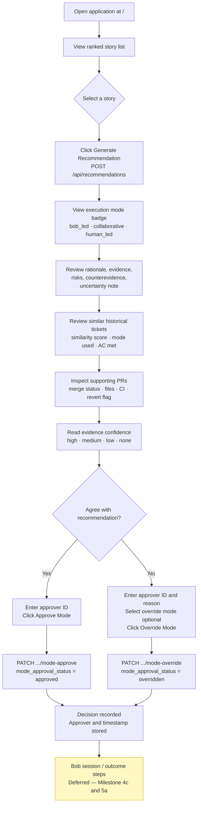
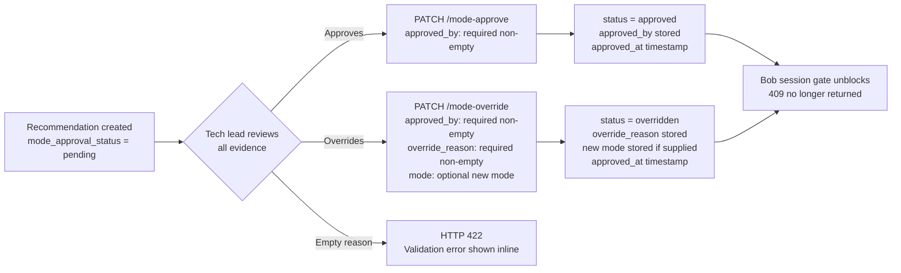

# Bob Intelligence — Business User Workflow & Functional Requirements

> **Source of truth:** This document was produced by analyzing the implemented codebase as of the current `dev-sp` branch.
> Every API endpoint, field name, validation rule, and status flag is traced to actual source files.
> Facts from code are labeled **[Implemented]**. Deferred features are labeled **[Deferred]**.

---

## Contents

1. [Executive Summary and Business Value](#1-executive-summary-and-business-value)
2. [User Personas and Responsibilities](#2-user-personas-and-responsibilities)
3. [End-to-End User Journey](#3-end-to-end-user-journey)
4. [Screen-by-Screen Functional Specification](#4-screen-by-screen-functional-specification)
5. [Complete Button and Interaction Inventory](#5-complete-button-and-interaction-inventory)
6. [API-to-UI Mapping](#6-api-to-ui-mapping)
7. [State, Validation, Error, and Empty-State Behavior](#7-state-validation-error-and-empty-state-behavior)
8. [MVP Scope vs Deferred Scope](#8-mvp-scope-vs-deferred-scope)
9. [Proposed Navigation and Screen Hierarchy](#9-proposed-navigation-and-screen-hierarchy)
10. [Acceptance Criteria for the Frontend](#10-acceptance-criteria-for-the-frontend)
11. [Implementation Gaps Before Frontend Development](#11-implementation-gaps-before-frontend-development)

---

## 1. Executive Summary and Business Value

### Problem Being Solved

Engineering teams lose time deciding **which ticket to work on next** and **whether that work is safe to delegate to IBM Bob Headless** (an AI coding assistant). Without a structured decision framework, tech leads make these calls manually, relying on instinct rather than evidence. The result is inconsistent execution modes, missed patterns from resolved historical work, and no institutional record of what worked and why.

### What Bob Intelligence Does

Bob Intelligence is a decision-support tool that:

1. **Ranks open Jira stories by urgency and readiness** — using Jira priority, blockers, acceptance criteria quality, open unknowns in the description, and status signals. This ranking is advisory; the tech lead selects which story to work on.

2. **Recommends an execution mode** — `bob_led`, `collaborative`, or `human_led` — for the selected ticket. The recommendation is driven by:
   - Story structure signals (AC completeness, blockers, open unknowns in description)
   - Semantically similar resolved tickets (TF-IDF cosine similarity, ≥0.25 threshold, top 5) and their recorded outcomes
   - GitHub PR metadata from those similar tickets (merge status, test file presence, revert detection, CI check runs)
   - LLM analysis of PR diffs and story context — IBM Bob Headless is the default provider (`LLM_PROVIDER=bob`); falls back to `collaborative` with an explicit warning when `LLM_API_KEY` is absent
   - Evidence confidence rating (`high` / `medium` / `low` / `none`) based on how many similar tickets have recorded outcomes

3. **Requires a human approval gate** — the tech lead must explicitly approve or override the execution mode before any Bob session can be linked or any outcome recorded. This gate is enforced at the API level with HTTP 409 Conflict.

4. **Stores the decision record permanently** — every recommendation with its full evidence chain, rationale, risks, counterevidence, and uncertainty note is persisted in SQLite and retrievable by ID.

### What Bob Intelligence Does Not Do (MVP Boundaries)

- Does not execute Bob sessions or communicate with Bob directly — session linking is **deferred** (Milestone 4c).
- Does not record or compare outcomes — **deferred** (Milestones 5a/5b).
- Does not rank or recommend developers — **permanently deferred** from MVP.
- Does not learn from outcomes automatically — **deferred** (Milestone 5b requires outcome recording first).
- Does not authenticate users — no user account system exists.
- Does not use `story_points` for any recommendation — explicitly excluded from all scoring logic.

### Business Value Statement

A tech lead opening this tool gets, in under two minutes, a structured, evidence-backed answer to: *"Should I send this ticket to Bob, work on it collaboratively, or handle it myself — and why?"* The answer references the team's own resolved ticket history, actual PR diffs from GitHub, and flags every uncertainty explicitly. The decision is recorded with the approver's identity and timestamp, creating an auditable trail.

---

## 2. User Personas and Responsibilities

### Primary Persona — Tech Lead / Engineering Manager

| Attribute | Detail |
|-----------|--------|
| Role | Technical decision-maker responsible for sprint planning and execution quality |
| System knowledge | Understands Jira, GitHub, and the concept of AI-assisted coding; does not need to understand TF-IDF, cosine similarity, or LLM prompting |
| Responsibility in this system | Selects a story; reviews the priority ranking and rationale; reviews the execution mode recommendation and all supporting evidence; approves or overrides the mode before work begins |
| What they decide | Whether the recommended execution mode is appropriate given the evidence shown. If overriding, they provide a mandatory non-empty written reason. |
| What they do NOT decide | Which developer to assign (deferred); whether the LLM is correct (uncertainty is surfaced explicitly by the system) |

### Secondary Persona — Developer (Future, Deferred)

Not part of the current MVP. Developer assignment (Decision 3) is permanently deferred. Developers are not expected to interact with this tool during the MVP phase.

---

## 3. End-to-End User Journey

### Primary Journey



### Approval / Override Flow



### Step-by-Step Journey Table

| Step | User Action | System Response | Data Involved | Status |
|------|-------------|-----------------|---------------|--------|
| 1 | Opens application at `/` | Displays list of imported stories | `GET /api/stories` | **[Implemented]** |
| 2 | Optionally imports stories | Loads sample data or fetches from Jira | `POST /api/stories/import` | **[Implemented]** |
| 3 | Selects a story | Navigates to `/stories/:id/recommendation` | Story ID | **[Implemented]** |
| 4 | Clicks "Generate Recommendation" | Runs priority ranking, TF-IDF similarity, GitHub PR enrichment, LLM mode analysis | `POST /api/recommendations` | **[Implemented]** |
| 5 | Reviews priority rank | Sees rank among all open stories, evidence items, rationale | `priority_rank`, `priority_rationale`, `priority_evidence[]` | **[Implemented]** |
| 6 | Reviews execution mode | Sees `bob_led`, `collaborative`, or `human_led` badge with rationale | `mode`, `mode_rationale` | **[Implemented]** |
| 7 | Reads evidence items | Reads each evidence item with source tag and verified flag | `mode_evidence[]` | **[Implemented]** |
| 8 | Reads risks and counterevidence | Sees risk severity and counterevidence notes | `mode_risks[]`, `mode_counterevidence[]` | **[Implemented]** |
| 9 | Reads uncertainty note and confidence | Understands what drove or limited the recommendation | `uncertainty_note`, `evidence_confidence` | **[Implemented]** |
| 10 | Reviews similar historical tickets | Sees up to 5 tickets: key, title, similarity score, resolution, mode used, AC met | `similar_tickets[]` | **[Implemented]** |
| 11 | Inspects supporting PRs | Clicks PR URL to open on GitHub; reads merge status, files, CI checks, revert flag | `supporting_prs[]` | **[Implemented]** |
| 12 | Reviews code analysis notes | Reads LLM-generated prose summary of PR diffs | `code_analysis_notes` | **[Implemented — null when LLM key absent]** |
| 13 | Reviews ticket readiness panel | Sees LLM readiness verdict: sufficiency, blocking gaps, evidence relevance, needed context, and suggested mode | `ticket_readiness` | **[Implemented — populated when `LLM_API_KEY` configured; `null` when LLM unavailable]** |
| 14 | Approves or overrides mode | Enters approver ID; clicks Approve or Override with reason | `PATCH .../mode-approve` or `PATCH .../mode-override` | **[Implemented]** |
| 15 | Sees decision confirmation | Approval status updates; timestamp and approver visible | Updated `RecommendationResponse` | **[Implemented]** |
| 16 | Proceeds to Link Bob Work | Navigates to `/stories/:id/bob-session` | `POST /api/bob-sessions` returns 501 | **[Deferred — Milestone 4c]** |
| 17 | Records outcome | Navigates to `/stories/:id/outcome` | `POST /api/outcomes` returns 501 | **[Deferred — Milestone 5a]** |

---

## 4. Screen-by-Screen Functional Specification

> **Legend:**
> - ✅ Backend fully implemented
> - 🟡 Backend partial / stub
> - 🔴 Deferred — backend returns 501
> - ⬜ Proposed UX — no code yet

---

### Screen 1 — Story Selector (Route: `/`)

**Business Purpose:** Allow the tech lead to find a ticket to evaluate, by loading built-in sample data or importing a live Jira story.

**Current State [Implemented]:** [`frontend/src/pages/StorySelector.tsx`](../frontend/src/pages/StorySelector.tsx) is fully implemented — API calls wired, filter tabs, import panel, metric cards, story rows with badges.

#### Information Displayed

| Field | Source | Notes |
|-------|--------|-------|
| Page title "Bob Intelligence" | Static | — |
| Metric cards: total / high-priority / blocked counts | Computed from `stories[]` | Always visible when stories loaded |
| Filter tabs: All / High Priority / Blocked / Jira / Sample | Client-side filter on `stories[]` | Narrows visible rows in real time |
| Sample data banner (yellow) | `story.source === "sample"` for any story | Persistent, non-dismissible |
| Story list | `GET /api/stories` → `StoryListResponse.stories[]` | Filtered by active tab |
| Per-row: Jira key, title, status badge, priority badge, source badge, blocker indicator | `StoryResponse` fields | Blocked stories show ⚠ indicator |
| Source tag `[SAMPLE]` or `[JIRA]` | `story.source` | Always visible per row |
| "No stories yet" empty state | When `total === 0` | With import call-to-action |
| Import panel | Collapsible | Opens/closes via "Import Stories" button |

#### Available Controls

| Control | Type | Purpose |
|---------|------|---------|
| "Import Stories" | Button | Opens/closes collapsible `ImportPanel` |
| "Load Sample Stories" (in panel) | Button | Calls `POST /api/stories/import {"import_source":"sample"}` |
| Jira key text input (in panel) | Text field | Accepts a key such as `PIE-42` |
| "Import from Jira" (in panel) | Button | Calls `POST /api/stories/import {"import_source":"jira","jira_key":"..."}` |
| Filter tabs | Tab group | Client-side filter: All / High Priority / Blocked / Jira / Sample |
| Story row | Clickable | Navigates to `/stories/:id/recommendation` |
| Refresh (in header) | Icon button (via `AppShell`) | Calls `GET /api/stories` again |

#### States

| State | Trigger | Display |
|-------|---------|---------|
| Loading | During initial `GET /api/stories` | `StoryRowSkeleton` rows |
| Empty | `total === 0` | `EmptyState` component with "No stories imported yet" + import call-to-action |
| Sample data loaded | Any story has `source === "sample"` | Yellow `SampleDataBanner` (persistent, non-dismissible) |
| Jira credentials missing | `source_status === "credentials_missing"` | `ErrorBanner` showing exact `source_warning` text |
| Jira API error | `source_status === "jira_error"` | `ErrorBanner` showing exact `source_warning` text |
| Duplicate skipped | `skipped_duplicates > 0` | `WarningBanner`: "N story(ies) already existed — skipped." |
| Filter active | Active tab other than "All" | Only matching rows shown; empty message if none pass |

---

### Screen 2 — Recommendation View (Route: `/stories/:id/recommendation`)

**Business Purpose:** Show the complete execution-mode recommendation with all evidence, confidence signals, and the mandatory approval/override gate. This is the primary screen of the application.

**Current State [Implemented]:** [`frontend/src/pages/RecommendationView.tsx`](../frontend/src/pages/RecommendationView.tsx) is fully implemented — all evidence panels rendered, approval gate interactive, `ApprovalPanel` extracted as a separate component.

#### Section A — Story Header

| Field | Source | Notes |
|-------|--------|-------|
| Story title | `story.title` | |
| Jira key (external link to Jira) | `story.jira_key` | Opens Jira in new tab if base URL is known |
| Status badge | `story.status` | |
| Priority badge | `story.priority` | `highest`/`high`/`medium`/`low`/`lowest` |
| Blockers warning | `story.blockers[]` | List of blocking keys in red; shown only when non-empty |
| Source tag | `story.source` | `[SAMPLE]` or `[JIRA]` |
| Sample data banner | `story.source === "sample"` | Same yellow banner as Screen 1 |

#### Section B — Priority Rank (Advisory — No Approval Gate)

| Field | Source | Notes |
|-------|--------|-------|
| Rank | `priority_rank` | "Ranked #2 of 5 open stories" |
| Rationale | `priority_rationale` | One-sentence prose from rule engine |
| Evidence list | `priority_evidence[]` | Expandable; each item: `source`, `description`, `verified` badge |

> **Important:** Priority rank is advisory only. The tech lead selects the story to work on. There is no approval gate for prioritization. Source: [`backend/routers/recommendations.py`](../backend/routers/recommendations.py).

#### Section C — Execution Mode Recommendation

| Field | Source | Notes |
|-------|--------|-------|
| Mode badge | `mode` | `bob_led` (green), `collaborative` (blue), `human_led` (amber) |
| Mode rationale | `mode_rationale` | LLM-generated 2–4 sentence prose; fallback prose when LLM unavailable |
| Evidence list | `mode_evidence[]` | Each item: `source`, `description`, `verified` badge |
| Risks list | `mode_risks[]` | Each item: `description`, `severity` — color-coded high=red, medium=amber, low=yellow |
| Counterevidence list | `mode_counterevidence[]` | Plain text items; always at least one present |
| Uncertainty note | `uncertainty_note` | Yellow callout box; always non-null |
| Evidence confidence | `evidence_confidence` | Badge: `high` (green) / `medium` (amber) / `low` (red) / `none` (grey) |
| LLM unavailability warning | Detected in `uncertainty_note` when it starts with "NOT an evidence-based recommendation." | Show as a separate prominent warning banner |

**Mode Values and Meaning** (source: [`backend/services/recommendation_service.py`](../backend/services/recommendation_service.py)):

| Mode | Meaning |
|------|---------|
| `bob_led` | Strong evidence, clear requirements, no blockers — Bob can own execution |
| `collaborative` | Useful evidence with uncertainty or open questions — Bob assists, human reviews |
| `human_led` | High ambiguity, missing AC, active blockers, or conflicting evidence — human drives |

> When `LLM_API_KEY` is absent, mode always defaults to `collaborative` with an explicit non-evidence-based warning.

#### Section D — Historical Evidence Panel

> Source fields: `similar_tickets[]`, `supporting_prs[]`, `evidence_confidence`, `code_analysis_notes`, `pr_evidence_warnings[]` from `RecommendationResponse`. Source: [`backend/services/historical_evidence_service.py`](../backend/services/historical_evidence_service.py).

| Field | Display Rule |
|-------|-------------|
| "Similar Resolved Tickets" heading | Show only when `similar_tickets.length > 0` |
| Empty state | "No similar resolved tickets found. Recommendation is based on story metadata only." |
| Each ticket row | `jira_key`, `title`, `similarity_score` (formatted to 2 dp), `resolution`, `mode_used` badge, `ac_met` (✓ / ✗ / —) |
| "Supporting PRs" heading | Show only when `supporting_prs.length > 0` |
| Each PR row | `title` (if available), `url` as external link, `merged` badge, `test_files_present` flag, `was_reverted` flag (show ⚠ Risk when true), `ci_checks` count, `source_warning` inline when non-null |
| PR enrichment warnings | `pr_evidence_warnings[]` as collapsible list; hidden when empty |
| Code analysis notes | `code_analysis_notes` in grey callout; **hidden entirely when null** |

> **Important caveats to display accurately (from source code):**
> - `merged = true` does NOT mean acceptance criteria were met. Never imply it does.
> - `test_files_present` is a filename pattern heuristic, not a verified test run.
> - `was_reverted` is a PR title heuristic (contains "revert" + `#N`), not a confirmed revert.
> - `ci_checks` passing does NOT mean AC were met.

#### Section E — Ticket Readiness Panel

> Source field: `ticket_readiness` (`TicketReadinessSchema`) on `RecommendationResponse`.
> **[Implemented]** `analyze_ticket_readiness()` in [`backend/services/llm_service.py`](../backend/services/llm_service.py) is called from `generate()` in [`backend/services/recommendation_service.py`](../backend/services/recommendation_service.py) before `analyze_mode()`. The panel is populated on every recommendation when `LLM_API_KEY` is configured. It is `null` only when the LLM is unavailable — hide the panel in that case only.

| Field | Display |
|-------|---------|
| `ticket_readiness === null` | **Hide this entire section** — LLM was unavailable |
| `overall_status` | Color-coded header badge: `ready` (green ✓) / `ready_with_gaps` (amber ⚠) / `not_ready` (red ✗) |
| `summary` | Prose paragraph — the main readiness statement the tech lead reads first |
| `sufficiency_verdict` | Sub-badge: `sufficient` (green) / `partial` (amber) / `insufficient` (red) |
| `llm_recommended_mode` + `llm_confidence` | "LLM suggests: AI + human (high confidence)" — shown when non-null |
| `blocking_gaps[]` | Bulleted red list under "Blocking Gaps" — **hidden when empty** |
| `evidence_relevance` + `evidence_relevance_reason` | Badge + one sentence: e.g. "Partially Relevant — historical tickets share domain but resolution may differ" |
| `needed_context[]` | Bulleted list under "Additional Context Needed" — **hidden when empty** |
| `retrievability_notes[]` | Tags each `needed_context` item with "Auto-retrievable" or "Requires human input" |
| `auto_resolvable_gaps` / `human_required_gaps` | Summary line: "N gaps can be auto-resolved, N require human input" — hidden when both are 0 |
| `checks[]` | Always empty — the 7-step deterministic service is not used; do not render this field |

#### Section F — Approval Gate

**This is the primary required action. The user cannot proceed to Bob session or outcome recording without completing it.** The gate is enforced at the API level (HTTP 409 Conflict) by [`backend/routers/bob_sessions.py`](../backend/routers/bob_sessions.py) and [`backend/routers/outcomes.py`](../backend/routers/outcomes.py).

| Gate State | Display |
|------------|---------|
| `mode_approval_status === "pending"` | Full approval form (see controls below) |
| `mode_approval_status === "approved"` | Green callout: "✓ Mode Approved by [name] at [timestamp]" |
| `mode_approval_status === "overridden"` | Amber callout: "↩ Mode Overridden by [name] at [timestamp]. Reason: [reason]. New mode: [mode]" |

**Gate Controls (shown only when status is `"pending"`):**

| Control | Type | Validation |
|---------|------|-----------|
| "Your name or ID" input | Text field | Required, min length 1; validated client-side before API call |
| "Approve Mode" | Primary button | Requires non-empty approver ID |
| Override mode selector | Dropdown (`bob_led` / `collaborative` / `human_led`) | Optional; only used when overriding |
| "Override reason" textarea | Textarea | Required and non-empty when clicking "Override Mode" |
| "Override Mode" | Secondary/warning button | Requires non-empty approver ID + non-empty reason |

---

### Screen 3 — Link Bob Work (Route: `/stories/:id/bob-session`) 🔴 Deferred

**Current State:** Placeholder at [`frontend/src/pages/LinkBobWork.tsx`](../frontend/src/pages/LinkBobWork.tsx). `POST /api/bob-sessions` returns **HTTP 501 Not Implemented** after the approval gate passes.

**Do not implement this screen until Milestone 4c is complete.** Show a disabled informational state:

> "Bob session linking will be available in a future release (Milestone 4c). The approval gate is enforced — work may not proceed until the execution mode is approved."

---

### Screen 4 — Outcome & Comparison (Route: `/stories/:id/outcome`) 🔴 Deferred

**Current State:** Placeholder at [`frontend/src/pages/OutcomeComparison.tsx`](../frontend/src/pages/OutcomeComparison.tsx). `POST /api/outcomes` and `POST /api/comparisons` both return **HTTP 501**.

**Do not implement this screen until Milestone 5a is complete.** Show a disabled informational state:

> "Outcome recording and comparison will be available in a future release (Milestone 5)."

---

## 5. Complete Button and Interaction Inventory

### Screen 1 — Story Selector

| # | Control | User Action | Purpose | Preconditions | System Behavior | API Dependency | Visible Result | Failure Behavior | Status |
|---|---------|-------------|---------|---------------|-----------------|----------------|----------------|------------------|--------|
| 1.1 | "Import Stories" toggle | Click | Open/close import panel | None | Toggles `ImportPanel` visibility | None | Panel appears/disappears | — | ✅ |
| 1.2 | "Load Sample Stories" (in panel) | Click | Import built-in sample stories | None | `POST /api/stories/import {"import_source":"sample"}` | `POST /api/stories/import` | Story list populated; yellow banner shown | Network error → `ErrorBanner` | ✅ |
| 1.3 | Jira key input (in panel) | Type | Enter a Jira issue key | Panel open | Stores input in local state | None | Text updates | — | ✅ |
| 1.4 | "Import from Jira" (in panel) | Click | Fetch one story from live Jira | Non-empty jira_key input | `POST /api/stories/import {"import_source":"jira","jira_key":"..."}` | `POST /api/stories/import` | Story added to list OR `ErrorBanner` with `source_warning` | Never silently substitute sample data | ✅ |
| 1.5 | Filter tabs | Click | Narrow story list client-side | Stories loaded | Client-side filter on priority / blocked / source | None | List narrows in real time | — | ✅ |
| 1.6 | Story row | Click | Open recommendation view | At least one story in list | Navigate to `/stories/:id/recommendation` | None | Route changes to Screen 2 | — | ✅ |

### Screen 2 — Recommendation View

| # | Control | User Action | Purpose | Preconditions | System Behavior | API Dependency | Visible Result | Failure Behavior | Status |
|---|---------|-------------|---------|---------------|-----------------|----------------|----------------|------------------|--------|
| 2.0 | Route load | Automatic | Load existing recommendation | Route enters | `GET /api/recommendations/by-story/{story_id}`; if 404 show generate button | `GET .../by-story/:id` | Recommendation shown immediately if exists; otherwise "Generate" button | 404 → generate button shown | ✅ |
| 2.1 | "Generate Recommendation" | Click | Trigger full recommendation pipeline | Story exists in DB; no current rec | `POST /api/recommendations {"story_id":"..."}` | `POST /api/recommendations` | All panels populate; approval gate shows as pending | 404 if story not found; `ErrorBanner` | ✅ |
| 2.2 | "Regenerate" / refresh | Click | Regenerate (previous superseded) | Recommendation already exists | Same call as 2.1; previous rec's status set to `"superseded"` | `POST /api/recommendations` | New recommendation shown | Same as 2.1 | ✅ |
| 2.3 | Evidence tab (Historical / PRs / Risks / Uncertainty) | Click | Switch evidence panel | Recommendation loaded | Tab state updates | None | Selected panel shown | — | ✅ |
| 2.4 | Evidence item | View | Read evidence source, description, verified flag | Recommendation loaded | Renders `EvidenceList` with source tag and verified badge | None | Evidence rows visible | — | ✅ |
| 2.5 | Risk item | View | Read risk description and severity | Recommendation loaded | Renders `RiskList` with colour-coded severity badge | None | Risk rows visible | — | ✅ |
| 2.6 | PR URL link | Click | Open PR on GitHub | `supporting_prs[].url` non-null | Opens URL in new browser tab (`target="_blank" rel="noopener noreferrer"`) | External (GitHub) | GitHub PR page opens | Dead link if PR deleted | ✅ |
| 2.7 | PR enrichment warning | View | Understand why PR data is partial | `source_warning` non-null on a PR | Warning text inline in PR card | None | Warning text visible | — | ✅ |
| 2.8 | Code analysis notes | View | Read LLM diff summary | `code_analysis_notes` non-null | Displayed in callout; hidden entirely when null | None | Notes visible (or absent) | — | ✅ |
| 2.9 | Approver ID input | Enter text | Identify the approving tech lead | Gate is `"pending"` | Stores value in `ApprovalPanel` local state | None | Input populated | Empty input shows client-side validation error | ✅ |
| 2.10 | "Approve Mode" | Click | Accept recommended mode as-is | `approved_by` non-empty; gate is `"pending"` | `PATCH /api/recommendations/:id/mode-approve {"approved_by":"..."}` | `PATCH .../mode-approve` | Gate turns green with approver + timestamp | 422 → error shown inline | ✅ |
| 2.11 | Override mode dropdown | Select | Choose replacement mode | Gate is `"pending"`; user intends to override | Updates `ApprovalPanel` local state | None | Dropdown shows selected value | — | ✅ |
| 2.12 | Override reason textarea | Enter text | Document why recommendation is rejected | User intends to override | Stores value in `ApprovalPanel` state | None | Textarea populated | Empty reason shows client-side validation error | ✅ |
| 2.13 | "Override Mode" | Click | Record override with mandatory reason | `approved_by` non-empty; `override_reason` non-empty; gate is `"pending"` | `PATCH /api/recommendations/:id/mode-override` with body | `PATCH .../mode-override` | Gate turns amber with reason, new mode, approver, timestamp | 422 → error shown inline | ✅ |
| 2.14 | "← Back to Stories" | Click | Return to story list | — | Navigate to `/` | None | Screen 1 shown | — | ✅ |
| 2.15 | "→ Link Bob Work" | Click | Proceed to Bob session step | Approval is `"approved"` or `"overridden"` | Navigate to `/stories/:id/bob-session` | None | Screen 3 shown (disabled informational state) | Hidden/disabled when approval pending | ✅ (gate enforced ✅) |

### Screens 3 and 4 (Deferred)

All controls on Screens 3 and 4 are **[Deferred]**. No interactive elements should be implemented. Both screens show an informational disabled state only.

---

## 6. API-to-UI Mapping

> Source: [`backend/routers/`](../backend/routers/), [`backend/schemas.py`](../backend/schemas.py), [`backend/main.py`](../backend/main.py)

### Endpoint Summary

| HTTP Method | Endpoint | UI Screen | UI Trigger | Key Response Fields |
|-------------|----------|-----------|------------|---------------------|
| `GET` | `/api/health` | App startup (background) | App load | `status` |
| `GET` | `/api/stories` | Screen 1 | Page load and refresh | `stories[]`, `total` |
| `POST` | `/api/stories/import` | Screen 1 | Import buttons in `ImportPanel` | `stories[]`, `source_status`, `source_warning`, `skipped_duplicates` |
| `GET` | `/api/stories/:id` | Screen 2 header | Route load | `title`, `jira_key`, `status`, `priority`, `blockers[]`, `source` |
| `GET` | `/api/recommendations/by-story/:id` | Screen 2 | Route load (before generate) | Full `RecommendationResponse` (404 if none) |
| `POST` | `/api/recommendations` | Screen 2 | "Generate Recommendation" | Full `RecommendationResponse` |
| `GET` | `/api/recommendations/:id` | Screen 2 | Load rec by explicit ID | Full `RecommendationResponse` |
| `PATCH` | `/api/recommendations/:id/mode-approve` | Screen 2 gate | "Approve Mode" in `ApprovalPanel` | `mode_approval_status`, `mode_approved_by`, `mode_approved_at` |
| `PATCH` | `/api/recommendations/:id/mode-override` | Screen 2 gate | "Override Mode" in `ApprovalPanel` | `mode_approval_status`, `mode_override_reason`, `mode`, `mode_approved_at` |
| `POST` | `/api/resolved-tickets/import` | Auto-seeded on startup | No manual UI trigger needed | `source_status`, `skipped_duplicates` |
| `GET` | `/api/resolved-tickets` | Setup only | Not surfaced in main UI | — |
| `POST` | `/api/bob-sessions` | Screen 3 | Deferred — returns 501 | — |
| `POST` | `/api/outcomes` | Screen 4 | Deferred — returns 501 | — |
| `POST` | `/api/comparisons` | Screen 4 | Deferred — returns 501 | — |

### `RecommendationResponse` Field-to-UI Mapping

| Field | UI Location | Display Format |
|-------|-------------|----------------|
| `id` | Store in state; not displayed | Used for PATCH calls |
| `story_id` | Store in state | — |
| `priority_rank` | Section B | "Ranked #N of M open stories" |
| `priority_rationale` | Section B | Prose paragraph |
| `priority_evidence[]` | Section B | Expandable list: source · description · verified badge |
| `mode` | Section C | Color-coded badge |
| `mode_rationale` | Section C | Prose paragraph |
| `mode_evidence[]` | Section C | List: source tag · description · verified badge |
| `mode_risks[]` | Section C | List: description · severity color badge |
| `mode_counterevidence[]` | Section C | Plain text list |
| `uncertainty_note` | Section C | Yellow callout box |
| `evidence_confidence` | Section C | Badge: high / medium / low / none |
| `mode_approval_status` | Section F | Gate state |
| `mode_approved_by` | Section F | "Approved by: [name]" |
| `mode_approved_at` | Section F | "at [timestamp]" |
| `mode_override_reason` | Section F | "Reason: [text]" |
| `similar_tickets[]` | Section D | Table: key · title · score · resolution · mode_used · ac_met |
| `supporting_prs[]` | Section D | List with external link, badges, warnings |
| `pr_evidence_warnings[]` | Section D | Collapsible list (hidden when empty) |
| `code_analysis_notes` | Section D | Grey callout (**hidden when null**) |
| `ticket_readiness.overall_status` | Section E | Color-coded header badge: ready / ready_with_gaps / not_ready |
| `ticket_readiness.summary` | Section E | Main prose paragraph |
| `ticket_readiness.sufficiency_verdict` | Section E | Sub-badge: sufficient / partial / insufficient |
| `ticket_readiness.llm_recommended_mode` + `.llm_confidence` | Section E | "LLM suggests: [mode] ([confidence] confidence)" |
| `ticket_readiness.blocking_gaps[]` | Section E | Bulleted red list — hidden when empty |
| `ticket_readiness.evidence_relevance` + `.evidence_relevance_reason` | Section E | Badge + one sentence |
| `ticket_readiness.needed_context[]` + `.retrievability_notes[]` | Section E | Bulleted list with auto/human tags — hidden when empty |
| `ticket_readiness.auto_resolvable_gaps` / `.human_required_gaps` | Section E | Summary counts — hidden when both 0 |
| `suggested_developer` | **Never rendered** | Always null in MVP |
| `dev_match_rationale` | **Never rendered** | Deferred |
| `dev_match_evidence[]` | **Never rendered** | Deferred |
| `dev_match_risks[]` | **Never rendered** | Deferred |
| `dev_match_approval_status` | **Never rendered** | Deferred |
| `is_stretch_assignment` | **Never rendered** | Deferred |
| `dev_match_approved_by` | **Never rendered** | Deferred |
| `dev_match_override_reason` | **Never rendered** | Deferred |

---

## 7. State, Validation, Error, and Empty-State Behavior

### Global Error States

| State | Trigger | Display |
|-------|---------|---------|
| Network error | `fetch()` throws | "Could not reach the server. Check that the backend is running on port 8000." + Retry button |
| HTTP 404 — story not found | `GET /api/stories/:id` returns 404 | "Story not found. It may have been removed." + link back to story list |
| HTTP 404 — recommendation not found | `GET /api/recommendations/:id` returns 404 | "Recommendation not found." + "Generate Recommendation" button |
| HTTP 500 | Any endpoint | "An unexpected server error occurred. Check backend logs." |

### Screen 1 Validation

| Input | Rule | Client Error | API Error to Surface |
|-------|------|-------------|---------------------|
| Jira key input | Non-empty before "Import from Jira" click | "Please enter a Jira key (e.g. PIE-42)." | — |
| Import response | `source_status === "credentials_missing"` | — | Show `source_warning` in red |
| Import response | `source_status === "jira_error"` | — | Show `source_warning` in red |

### Screen 2 Validation

| Input | Rule | Client Error | API Error to Surface |
|-------|------|-------------|---------------------|
| Approver ID input | Non-empty before Approve or Override | "Please enter your name or ID." | HTTP 422 `detail` text inline |
| Override reason textarea | Non-empty before Override | "A reason is required when overriding." | HTTP 422 `detail` text inline |
| Override mode dropdown | Must be one of the three valid modes | Enforced by dropdown — no free text | HTTP 422 if invalid value sent |

### Empty State Rules

| Scenario | Rule |
|----------|------|
| `similar_tickets.length === 0` | Show message: "No similar resolved tickets found. Recommendation is based on story metadata only." Do not render an empty table. |
| `supporting_prs.length === 0` | Hide the Supporting PRs section entirely. |
| `code_analysis_notes === null` | Hide the code analysis section entirely. Do not render `null` or an empty box. |
| `ticket_readiness === null` | Hide the readiness panel entirely. |
| `pr_evidence_warnings.length === 0` | Hide the warnings section entirely. |
| `suggested_developer === null` | Hide all developer match fields. Do not render "No developer suggested." |
| Story list `total === 0` | Show "No stories imported yet." with import call-to-action. |

### Source Data Warnings

Whenever `story.source === "sample"` or `resolved_ticket.source === "sample"`, display a persistent non-dismissible yellow banner:

> **⚠ Sample Data** — This content was imported from built-in sample data, not a live Jira instance. Results are for demonstration only.

The `source_warning` field from any import response must also be shown as an informational notice (not a blocking error) whenever it is non-null.

### LLM Unavailability

When `uncertainty_note` starts with `"NOT an evidence-based recommendation."`, display a prominent amber warning:

> **⚠ LLM Unavailable** — IBM Bob Headless could not be reached. The execution mode shown (`collaborative`) is a conservative default, not an evidence-based recommendation. Set `LLM_API_KEY` in `.env` to enable mode analysis.

---

## 8. MVP Scope vs Deferred Scope

### Fully Implemented — Available Now

| Feature | Source |
|---------|--------|
| Story import — sample and Jira | [`backend/routers/stories.py`](../backend/routers/stories.py) |
| Story list and detail | `GET /api/stories`, `GET /api/stories/:id` |
| Resolved ticket import — sample and Jira; auto-seeded on startup | [`backend/routers/resolved_tickets.py`](../backend/routers/resolved_tickets.py), [`backend/main.py`](../backend/main.py) lifespan |
| Priority ranking (deterministic rule engine) | [`backend/services/recommendation_service.py`](../backend/services/recommendation_service.py) |
| Execution mode recommendation (LLM-based with deterministic fallback) | Same file |
| TF-IDF cosine similarity — top 5 similar resolved tickets | [`backend/services/historical_evidence_service.py`](../backend/services/historical_evidence_service.py) |
| GitHub PR enrichment — merge, files, test detection, revert heuristic, CI checks | [`backend/services/github_service.py`](../backend/services/github_service.py) |
| Evidence confidence rating | `historical_evidence_service.compute_evidence_confidence()` |
| `GET /api/recommendations/by-story/:id` — latest rec for story | [`backend/routers/recommendations.py`](../backend/routers/recommendations.py) |
| Mode approval gate (`PATCH .../mode-approve`) | Same file |
| Mode override gate (`PATCH .../mode-override`) | Same file |
| Downstream gate enforcement (bob-sessions and outcomes return 409 while pending) | [`backend/routers/bob_sessions.py`](../backend/routers/bob_sessions.py), [`backend/routers/outcomes.py`](../backend/routers/outcomes.py) |
| Recommendation persistence and GET by ID | Same router |
| PR evidence warnings in recommendation response | `pr_evidence_warnings[]` field |
| Code analysis notes (LLM — null when no key) | `code_analysis_notes` field |
| Ticket readiness assessment (LLM — null when no key) | `ticket_readiness` field — `analyze_ticket_readiness()` in [`backend/services/llm_service.py`](../backend/services/llm_service.py) |
| **StorySelector** — full UI, API wired, filter tabs, import panel | [`frontend/src/pages/StorySelector.tsx`](../frontend/src/pages/StorySelector.tsx) |
| **RecommendationView** — full UI, all panels, approval gate | [`frontend/src/pages/RecommendationView.tsx`](../frontend/src/pages/RecommendationView.tsx) |
| Frontend typed API client — all MVP endpoints | [`frontend/src/api/client.ts`](../frontend/src/api/client.ts) |
| Frontend TypeScript types — all response shapes | [`frontend/src/api/types.ts`](../frontend/src/api/types.ts) |
| AppShell, ApprovalPanel, shared UI components | [`frontend/src/components/`](../frontend/src/components/) |
| Docker + Docker Compose multi-service deployment | [`docker-compose.yml`](../docker-compose.yml) |


### Deferred — Backend Returns 501

| Feature | Endpoint | Milestone |
|---------|----------|-----------|
| Bob session creation and confirmation | `POST /api/bob-sessions` | 4c |
| Bob session retrieval | `GET /api/bob-sessions/:story_id` | 4c |
| Outcome recording | `POST /api/outcomes` | 5a |
| Outcome retrieval | `GET /api/outcomes/:story_id` | 5a |
| Comparison generation | `POST /api/comparisons` | 5b |
| Comparison retrieval | `GET /api/comparisons/:story_id` | 5b |
| Self-learning (outcome → resolved ticket promotion) | Internal service | 5b |
| Developer match recommendation | All `dev_match_*` fields | 8 |

### Fields to Never Render in MVP

The following fields are present in `RecommendationResponse` but are always null/empty in the MVP. **Do not render them.** Showing empty sections would confuse users.

- `suggested_developer`, `dev_match_rationale`, `dev_match_evidence[]`, `dev_match_risks[]`
- `is_stretch_assignment`, `stretch_support_plan`
- `dev_match_approval_status`, `dev_match_approved_by`, `dev_match_approved_at`, `dev_match_override_reason`

---

## 9. Proposed Navigation and Screen Hierarchy

### Route Structure

```
/                                     ← Screen 1: Story Selector
  └─ /stories/:id/recommendation      ← Screen 2: Recommendation View  ← PRIMARY SCREEN
       ├─ /stories/:id/bob-session     ← Screen 3: Link Bob Work        [DEFERRED — 501]
       └─ /stories/:id/outcome         ← Screen 4: Outcome & Comparison [DEFERRED — 501]
```

> Route structure already defined in [`frontend/src/main.tsx`](../frontend/src/main.tsx).

### Navigation Rules

1. **Screen 1 → Screen 2:** Click any story row (or navigate directly to `/stories/:id/recommendation`).
2. **Screen 2 → Screen 3:** Only when `mode_approval_status` is `"approved"` or `"overridden"`. The button is hidden or disabled while approval is pending. Screen 3 shows a "coming soon" informational state — do not attempt the `POST /api/bob-sessions` call.
3. **Screen 3 → Screen 4:** Only when a confirmed Bob session exists. Screen 4 shows a disabled informational state.
4. **Back navigation:** Every screen shows a "← Back" link at the top.

### Screen 2 Layout Recommendation

Screen 2 carries the most information. A two-column layout on wider viewports, single column on mobile:

```
┌─────────────────────────────────────────────────────────────────┐
│  ← Back to Stories   │  PIE-2 — Add POST /login endpoint        │
│                       │  Status: Ready for Dev  Priority: High  │
├───────────────────────┬─────────────────────────────────────────┤
│  PRIORITY RANK        │  EXECUTION MODE                         │
│  Ranked #1 of 2       │  ● COLLABORATIVE          [medium]      │
│  Rationale prose...   │  Mode rationale prose...                │
│  [Evidence ▼]         │  [Evidence ▼]                           │
│                       │  [Risks ▼]                              │
│                       │  [Counterevidence ▼]                    │
│                       │  ⚠ Uncertainty note prose               │
├───────────────────────┴─────────────────────────────────────────┤
│  HISTORICAL EVIDENCE                                             │
│  Similar Resolved Tickets (2)                                   │
│  ┌─────────────────────────────────────────────────────────────┐│
│  │ PIE-1  0.41  human_led  AC: ✓  Done                        ││
│  │ PIE-3  0.38  human_led  AC: ✓  Done                        ││
│  └─────────────────────────────────────────────────────────────┘│
│  Supporting PRs (2)                                              │
│  ┌─────────────────────────────────────────────────────────────┐│
│  │ PR #1  Merged ✓  Tests ✓  [github.com/...] ↗               ││
│  │ PR #2  Merged ✓  Tests ✓  [github.com/...] ↗               ││
│  └─────────────────────────────────────────────────────────────┘│
├─────────────────────────────────────────────────────────────────┤
│  APPROVAL GATE                                                   │
│  Tech lead approval required before work begins.                │
│  Your name or ID: [________________________]                    │
│  [Approve Mode]          [Override Mode ▼ + reason]             │
└─────────────────────────────────────────────────────────────────┘
```

---

## 10. Acceptance Criteria — Verification Checklist

### Screen 1 — Story Selector

- [x] All stories from `GET /api/stories` are listed on page load with `jira_key`, `title`, `status`, `priority`, blocker indicator.
- [x] Metric cards show total / high-priority / blocked counts.
- [x] Filter tabs (All / High Priority / Blocked / Jira / Sample) narrow the visible story rows client-side.
- [x] "Import Stories" button opens/closes the `ImportPanel`.
- [x] "Load Sample Stories" calls `POST /api/stories/import {"import_source":"sample"}` and refreshes the list.
- [x] Empty `jira_key` input prevents the "Import from Jira" call — client-side message shown.
- [x] `source_status === "credentials_missing"` or `"jira_error"` shows the exact `source_warning` text in `ErrorBanner`. Sample data is never silently substituted.
- [x] `source === "sample"` shows the yellow `SampleDataBanner`.
- [x] `skipped_duplicates > 0` shows a `WarningBanner`.
- [x] Clicking a story row navigates to `/stories/:id/recommendation`.
- [x] `EmptyState` is shown when `total === 0`.

### Screen 2 — Recommendation View

- [x] On route load, `GET /api/recommendations/by-story/{story_id}` is called first; existing recommendation loaded immediately if present.
- [x] Story header (`StoryContext`) shows `title`, `jira_key`, `status`, `priority`, `blockers[]` (with ⚠ when non-empty), `source` tag.
- [x] "Generate Recommendation" calls `POST /api/recommendations {"story_id":"..."}` when no recommendation exists.
- [x] `Skeleton` panels shown during loading; `ErrorBanner` on failure.
- [x] `priority_rank` displayed via `ModeHero`.
- [x] `mode` displayed as a color-coded `ModeBadge` (bob_led/collaborative/human_led).
- [x] `mode_rationale` shown as prose below the badge with `modeDescription()`.
- [x] Evidence inspector tabs: Historical / PRs / Risks / Uncertainty.
- [x] `mode_evidence[]` shown in `EvidenceList` with `source` tag and `verified` badge. Each item is an `EvidenceItem` object (`source`, `description`, `verified`).
- [x] `mode_risks[]` shown in `RiskList` with color-coded `severity` badges. Each item is a `RiskItem` object (`description`, `severity`).
- [x] `mode_counterevidence[]` shown as a list in `RisksPanel`.
- [x] `uncertainty_note` and `code_analysis_notes` shown in `UncertaintyPanel`.
- [x] `evidence_confidence` shown as a `ConfidenceBadge`.
- [x] LLM unavailability warning (`WarningBanner`) shown prominently when detected in `uncertainty_note`.
- [x] `similar_tickets[]` shown in `HistoricalTicketsPanel` when non-empty; informational message when empty.
- [x] `supporting_prs[]` shown in `PRsPanel` with external link, `merged` badge, `test_files_present` flag, `was_reverted` flag (with ⚠ when true), `source_warning` when non-null.
- [x] `pr_evidence_warnings[]` shown when non-empty; hidden when empty.
- [x] `code_analysis_notes` shown when non-null; **hidden entirely when null**.
- [x] `ticket_readiness` panel (`ReadinessPanel`) shown when non-null: `overall_status` badge, `summary`, `sufficiency_verdict`, `llm_recommended_mode` + `llm_confidence`, `blocking_gaps[]`, `evidence_relevance`, `needed_context[]`, gap counts. **Hidden entirely when null**.
- [x] No developer match fields rendered (`suggested_developer`, `dev_match_*` etc.).
- [x] `ApprovalPanel` renders the full form when `mode_approval_status === "pending"`.
- [x] Empty approver ID shows client-side validation error; no API call made.
- [x] "Approve Mode" calls `PATCH .../mode-approve {"approved_by":"..."}`.
- [x] After approval, gate shows green `ApprovalBadge` with approver name and timestamp.
- [x] "Override Mode" requires non-empty approver ID and non-empty override reason; client-side validation error when either is empty.
- [x] "Override Mode" calls `PATCH .../mode-override` with `approved_by`, `override_reason`, and optional `mode`.
- [x] After override, gate shows amber confirmation with reason, new mode, approver, timestamp.
- [x] API 422 error detail text is shown inline.
- [x] "→ Link Bob Work" hidden when `mode_approval_status === "pending"`.
- [x] Screen 3 link navigates but shows informational state — does not call `POST /api/bob-sessions`.

### General

- [x] App starts with `npm run dev` and connects to backend at `http://localhost:8000`.
- [x] CORS works correctly (backend allows `localhost:5173`).
- [x] All external PR links open in a new browser tab with `rel="noopener noreferrer"`.
- [x] All API errors render user-readable messages via `ErrorBanner`, not raw JSON or stack traces.
- [x] Sample data banner shown on every screen where `source === "sample"` data is present.
- [x] All `source_warning` text from API responses is surfaced to the user — never silently discarded.

---

## 11. Implementation Gaps Before Frontend Development

### Remaining Gaps — Do Not Block MVP

| Gap | Detail | Status |
|-----|--------|--------|
| `POST /api/bob-sessions` returns 501 | Session creation deferred | `LinkBobWork.tsx` shows informational "coming soon" state; does not call the endpoint |
| `POST /api/outcomes` returns 501 | Outcome recording deferred | `OutcomeComparison.tsx` shows informational disabled state |
| No pagination on story list | `GET /api/stories` returns all records | Acceptable at demo scale |
| LLM fallback always returns `collaborative` | When `LLM_API_KEY` is absent, mode defaults to `collaborative` | Warning surfaced prominently from `uncertainty_note` |
| Sample resolved tickets corpus is small | Only a few entries in [`backend/sample_data/resolved_tickets.json`](../backend/sample_data/resolved_tickets.json) | Sufficient for demo; `similar_tickets` populated for sample stories |
| `ticket_readiness` is null on pre-M4c records | Older records may lack readiness data | Already handled — panel hidden when null |

### Running the Application End-to-End

The application is fully runnable. No additional implementation steps are required for the core user journey:

```bash
# Terminal 1 — Backend
python -m venv .venv && source .venv/bin/activate
pip install -r backend/requirements.txt
cp backend/.env.example backend/.env   # configure LLM_API_KEY for full analysis
uvicorn backend.main:app --reload --port 8000

# Terminal 2 — Frontend
cd frontend && npm install && npm run dev
```

Then open `http://localhost:5173`. On first run, sample resolved tickets are seeded automatically.

### Verification Checklist

1. `GET /api/health` returns `{"status":"ok"}`.
2. StorySelector loads with filter tabs and "Import Stories" button.
3. "Load Sample Stories" imports stories; yellow sample banner appears.
4. Clicking a story row navigates to `/stories/:id/recommendation`.
5. RecommendationView shows story context; "Generate Recommendation" button shown.
6. Generating a recommendation populates all panels (mode badge, evidence tabs, readiness panel).
7. Approval gate accepts approver ID; "Approve Mode" sets status to `approved`.
8. Override gate requires non-empty reason; "Override Mode" sets status to `overridden`.
